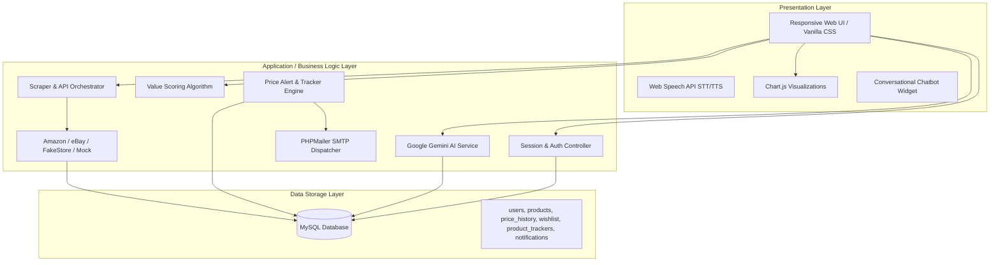
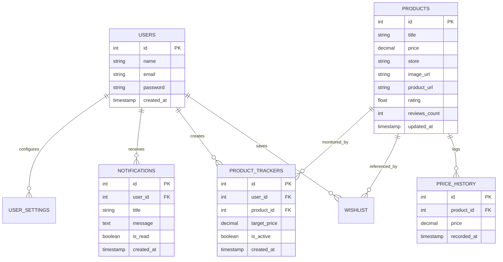

# BharatBuy - Smart E-Commerce Shopping Assistant

<div align="center">


[](https://www.php.net/)
[](https://www.mysql.com/)
[](https://ai.google.dev/)
[](https://www.chartjs.org/)
[](https://github.com/PHPMailer/PHPMailer)
[](LICENSE)

**Empowering Indian online consumers with real-time price comparison, intelligent value scoring, automated price drop notifications, and AI conversational assistance.**

[Explore Features](#core-features) • [Architecture](#system-architecture) • [Getting Started](#installation--setup) • [Configuration](#configuration--environment-variables) • [Database Schema](#database-architecture)

</div>

---

## Overview & Problem Statement

In the modern digital economy, online shopping is fragmented across numerous platforms (Amazon, eBay, Flipkart, Walmart, etc.). The same product is often listed with wildly fluctuating dynamic prices, hidden shipping fees, and varying seller ratings.

### The "Cheapest Price" Trap
Traditional price comparison tools simply sort listings by lowest price. This creates serious pitfalls:
- ❌ **Low Quality / Scam Risk**: The cheapest option often has terrible customer ratings or high failure rates.
- ❌ **Accessory Pollution**: Searching for high-ticket smartphones (e.g., *iPhone 15 Pro*, *OnePlus 11*) floods search results with ₹199 phone cases, chargers, and tempered glass guards instead of the actual phone.
- ❌ **Manual Tracking Fatigue**: Shoppers spend hours re-checking websites hoping for festival sale price drops.

### The BharatBuy Solution
**BharatBuy** is a comprehensive, intelligent e-commerce assistant that unifies cross-platform searches, evaluates deals using a proprietary **Value Score Recommendation Engine (1-100)**, tracks historical price fluctuations with interactive visual charts, delivers automated email alerts via **SMTP/PHPMailer**, and embeds an interactive **Google Gemini AI Assistant** with voice controls.

---

## Core Features

### 1. Unified Multi-Platform Search & Aggregation
- **Cross-Platform Scraping & Providers**: Orchestrates simultaneous queries across **Amazon**, **eBay**, **FakeStore**, **DummyJSON**, and an intelligent **High-Fidelity Mock Engine**.
- **Smart Accessory Filter**: Automatically detects and separates low-cost accessory noise (cases, cables, adapters) when searching for high-value devices.
- **Real-Time Currency Conversion**: Converts international listings ($ USD / € EUR) seamlessly to Indian Rupees (₹ INR) using cached live exchange rates.

### 2. Intelligent Value Scoring Algorithm (0 - 100)
Rather than solely sorting by price, BharatBuy calculates a holistic **Value Score** for every item:
$$\text{Value Score} = (0.40 \times \text{Price Score}) + (0.30 \times \text{Rating Score}) + (0.30 \times \text{Review Count Score})$$
- Automatically tags and highlights the top-ranking product as the **"Best Overall Deal"** at the top of the search grid.

### 3. Interactive Price History & Trend Analytics
- **Live Price Logging**: Every search updates historical records in MySQL.
- **Chart.js Visualizations**: Displays historical highs, lows, and moving averages on dynamic canvas charts.
- **Dynamic Flat Baseline**: Generates a smooth horizontal baseline for brand-new listings without prior history.

### 4. Automated Price Drop Trackers & Email Alerts
- **Custom Price Thresholds**: Set a target price on any product page.
- **Automated SMTP Mail Dispatcher**: Sends instant HTML-styled price-drop notifications via **PHPMailer** using Gmail App Passwords.
- **UTF-8 Support & Sanitization**: Full UTF-8 support ensures notification subjects (e.g. `Price Drop Alert for iPhone 15`) display cleanly without garbled characters.

### 5. Google Gemini AI Assistant with Voice Interface
- **Natural Language Shopping Queries**: Ask questions like *"Compare the best wireless noise-canceling headphones under ₹5000"*.
- **Integrated Voice Capabilities**:
  - **Speech-to-Text (STT)**: Voice search using the Web Speech API.
  - **Text-to-Speech (TTS)**: Reads out AI advice with sanitized pictographic speech synthesis.
- **Local Fallback Mode**: Automatically switches to local rule-based recommendations if the Gemini API is offline.

### 6. User Dashboard & Gmail-Style Account Switcher
- **Profile Hub**: Manage active price trackers, wishlists, and notification logs in one place.
- **Account Switcher**: Gmail-style multi-account profile card on the login screen for quick, seamless local user switching.
- **Password Security**: Fully hashed passwords using industry-standard `bcrypt`.

---

## System Architecture

BharatBuy follows a clean **Three-Tier Modular Architecture**:



---

## Tech Stack

| Domain | Technology / Library | Purpose |
|---|---|---|
| **Backend Core** | PHP 8.0+ | Server-side logic, routing, API endpoints, session security |
| **Database** | MySQL 8.0 / MariaDB (PDO) | Normalized relational storage, transactions, prepared queries |
| **Artificial Intelligence** | Google Gemini Pro / Flash API | Conversational natural language shopping consultant |
| **Frontend Styling** | Vanilla CSS3 (Custom Tokens) | Clean responsive design, dark-mode accents |
| **Frontend Scripting** | Vanilla JavaScript (ES6+) | Asynchronous AJAX flows, TTS/STT speech synthesis, DOM manipulation |
| **Data Visualization** | Chart.js 4.4 | Interactive price history line charts |
| **Email Service** | PHPMailer 6.9 | Secure TLS SMTP notifications with UTF-8 character encoding |
| **External Providers** | cURL / REST APIs | Live data fetching from eBay, DummyJSON, FakeStore, Amazon Ninja |

---

## Database Architecture

The relational schema is configured in [`database/bharatbuy.sql`](database/bharatbuy.sql) / [`database/smart_shopping_assistant_backup.sql`](database/smart_shopping_assistant_backup.sql):



---

## Installation & Setup

### Prerequisites
- [XAMPP](https://www.apachefriends.org/) (Apache + MySQL + PHP 8.0 or higher)
- [Git](https://git-scm.com/)

### Step 1: Clone the Repository
Clone the project into your local web root directory (`htdocs` for XAMPP):
```bash
cd C:/xampp/htdocs
git clone https://github.com/Param85/BharatBuy.git
cd BharatBuy
```

### Step 2: Database Import
1. Start **Apache** and **MySQL** in the XAMPP Control Panel.
2. Open **phpMyAdmin** (`http://localhost/phpmyadmin/`).
3. Create a new database named `smart_shopping_assistant`.
4. Click on **Import** and select [`database/smart_shopping_assistant_backup.sql`](database/smart_shopping_assistant_backup.sql) (or [`database/bharatbuy.sql`](database/bharatbuy.sql)).
5. Click **Go** to create the tables and seed data.

### Step 3: Environment Configuration (`.env`)
Create a `.env` file in the root directory:
```env
# Database Credentials
DB_HOST=localhost
DB_NAME=smart_shopping_assistant
DB_USER=root
DB_PASS=

# Google Gemini AI Key
GEMINI_API_KEY=your_gemini_api_key_here

# SMTP Email Configuration (Gmail App Password)
SMTP_HOST=smtp.gmail.com
SMTP_PORT=587
SMTP_USER=your_email@gmail.com
SMTP_PASS=your_16_character_app_password
SMTP_FROM=your_email@gmail.com
SMTP_FROM_NAME=BharatBuy Price Alerts

# Upstream API Keys (Optional)
RAPIDAPI_KEY=your_rapidapi_key
EBAY_APP_ID=your_ebay_app_id
```

> **Note**: The `.env` file contains sensitive credentials and is permanently excluded in `.gitignore`. Never commit `.env` to public repositories.

### Step 4: Run the Application
Open your web browser and navigate to:
```
http://localhost/BharatBuy/
```

---

## Project Directory Structure

```
BharatBuy/
├── ajax/                        # Asynchronous endpoints (Chatbot, Alerts, Search, Wishlist)
│   ├── chatbot.php                 # Gemini AI bridge with local fallback
│   ├── check-alerts.php            # Price threshold evaluation & trigger script
│   ├── deactivate_tracker.php      # Safe alert deactivation & mail sync
│   ├── searchProduct.php           # Aggregated multi-provider product search
│   └── wishlist.php                # Add/remove user wishlist items
├── api/                         # REST API endpoints (Recommendations, Value Scoring)
├── assets/images/               # Branding assets and logos
├── css/                         # Custom stylesheets (Vanilla CSS)
│   ├── style.css                   # Main application UI stylesheet
│   └── dashboard.css               # User dashboard and profile grid styling
├── database/                    # SQL schema definitions and migrations
│   ├── bharatbuy.sql               # Base database schema
│   └── smart_shopping_assistant_backup.sql # Complete backup with sample data
├── includes/                    # Core backend logic & services
│   ├── config.php                  # Global application configuration & .env loader
│   ├── db.php                      # PDO database connection handler
│   ├── GeminiService.php           # Google Gemini API connector with system prompts
│   ├── mailer.php                  # PHPMailer SMTP client wrapper (UTF-8 enabled)
│   ├── scraper.php                 # Multi-platform product scraper orchestrator
│   ├── exchange_rate.php           # Currency conversion utility (USD -> INR)
│   ├── providers/               # Modular provider adapters
│   │   ├── BaseProvider.php
│   │   ├── AmazonNinjaProvider.php
│   │   ├── EbayProvider.php
│   │   ├── FakeStoreProvider.php
│   │   ├── DummyJsonProvider.php
│   │   └── MockProvider.php
│   └── PHPMailer/               # Embedded PHPMailer library files
├── js/                          # Client-side JavaScript logic
│   ├── chatbot.js                  # Chatbot UI, Speech-to-Text & Text-to-Speech logic
│   ├── search.js                   # Instant search, debounce, and filtering
│   ├── floating-background.js      # Interactive animated background canvas
│   └── settings.js                 # User preference toggles & alert controls
├── .gitignore                      # Git exclusion rules (.env, logs, IDE files)
├── dashboard.php                   # User profile, wishlist, and active price trackers
├── index.php                       # Homepage & central product search engine
├── login.php                       # Authentication & Gmail-style profile selector
├── product-details.php             # Detailed view with Chart.js price history
├── register.php                    # User registration with password hashing
└── README.md                       # Project documentation
```

---

## Testing & Verification

BharatBuy includes dedicated test utilities to verify external integrations:

- **Test Gemini AI API**:
  ```bash
  php test_gemini_api.php
  ```
- **Test SMTP Mail Dispatcher**:
  ```bash
  php test_smtp_mailer.php
  ```

---

## Security Practices

- **PDO Prepared Statements**: Prevents SQL injection across all authentication, search, and dashboard queries.
- **Bcrypt Password Encryption**: User passwords are cryptographically hashed using `password_hash($pass, PASSWORD_BCRYPT)`.
- **Environment Isolation**: All API tokens, database passwords, and SMTP credentials are encapsulated inside `.env`.
- **Input Sanitization**: Client-side queries and chatbot inputs are sanitized to protect against cross-site scripting (XSS).

---

## Contributing

Contributions, issues, and feature requests are welcome:
1. Fork the Project
2. Create your Feature Branch (`git checkout -b feature/AmazingFeature`)
3. Commit your Changes (`git commit -m 'Add some AmazingFeature'`)
4. Push to the Branch (`git push origin feature/AmazingFeature`)
5. Open a Pull Request

---

## License & Author

Distributed under the **MIT License**.

Developed by **[Param85](https://github.com/Param85)**.
