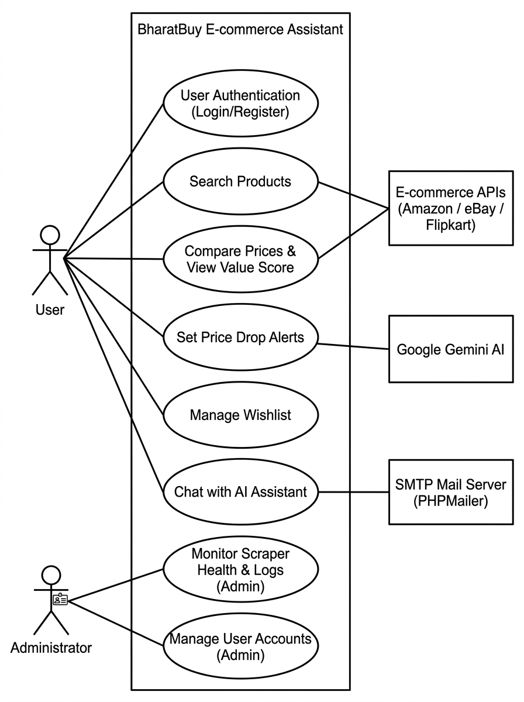

# BharatBuy: UML Use Case Documentation

## 1. Use Case Diagram

*Figure 1.0: UML Use Case Diagram for BharatBuy (India's Own AI-Assisted Shopping Platform).*

---

## 2. System Overview
**BharatBuy** is an intelligent e-commerce price comparison and tracking platform designed for the Indian shopping ecosystem. The system concurrently aggregates real-time product information from leading online stores (Amazon India, Flipkart, eBay Global, Croma), computes an algorithmic Smart Value Score, enables automated target price drop monitoring, and integrates a conversational AI Shopping Advisor powered by Google Gemini.

---

## 3. Actor Specification

| Actor | Classification | Role Description |
| :--- | :--- | :--- |
| **Guest / Shopper** | Human (Primary) | Unauthenticated user exploring the platform. Can search for products across stores, view side-by-side price comparison matrixes, filter categories, toggle currency/language localization, and consult the AI Shopping Assistant. |
| **Registered User** | Human (Primary) | Authenticated consumer inheriting all Guest rights, with access to personalized features: creating wishlists, establishing target price drop alerts, viewing in-app & email notifications, and inspecting search history. |
| **Administrator** | Human (Secondary) | Platform operator with elevated rights (`is_admin = 1`). Oversees platform stability, audits scraper latency/health logs, monitors AI query response times, manages user accounts, and reviews active price trackers. |
| **Marketplace Scrapers** | External System | Distributed scraper engines and REST APIs (Amazon, eBay, Flipkart, Croma, DummyJSON) queried concurrently to retrieve live pricing, ratings, discounts, and inventory availability. |
| **Google Gemini AI Engine** | External System | Cloud-based LLM providing real-time natural language buying advisory, specifications breakdown, technical comparisons, and product recommendations. |
| **PHPMailer / SMTP Engine** | External System | Transactional mail transport agent dispatching automated email notifications when tracked item prices reach user target thresholds. |

---

## 4. Use Case Specifications

### 4.1 UC-01: Multi-Store Product Search
* **Actors:** Guest / Shopper, Registered User, Marketplace Scrapers
* **Description:** User submits a product keyword or pasted merchant URL. The platform queries multiple e-commerce engines in parallel, normalizes response schemas into INR, caches results in `api_cache`, and presents sorted product cards.
* **Pre-conditions:** System connected to database and active network connection.
* **Post-conditions:** Aggregated results rendered on search results grid.
* **Relationships:** `<include>` UC-02 (View Live Price Comparison Matrix).

### 4.2 UC-02: View Live Price Comparison Matrix
* **Actors:** Guest / Shopper, Registered User, Marketplace Scrapers
* **Description:** Presents a side-by-side comparison table of the selected product across verified retailers showing seller identity, live price, discount depth, fulfillment status, and the BharatBuy Value Score (0–100).
* **Pre-conditions:** Search query executed or direct product selected.
* **Post-conditions:** Verified retailer rows and "Best Deal" badge rendered.

### 4.3 UC-03: Filter Categories & Convert Currency
* **Actors:** Guest / Shopper, Registered User
* **Description:** Allows users to narrow catalog items by department (Mobiles, Electronics, Fashion, Appliances) and toggle currency between INR (₹), USD ($), EUR (€), and GBP (£) with live FX conversion rates.
* **Pre-conditions:** Page loaded.
* **Post-conditions:** DOM updated with converted currencies and active category filter.

### 4.4 UC-04: Chat with AI Shopping Assistant
* **Actors:** Guest / Shopper, Registered User, Google Gemini AI Engine
* **Description:** Users interact with a conversational assistant in natural language to compare gadget specifications, review pros/cons, and get tailored buying guides. Includes voice Text-to-Speech (TTS) and speech recognition.
* **Pre-conditions:** Gemini API configured or fallback FAQ database populated.
* **Post-conditions:** Formatted conversational answer rendered in the chat drawer.

### 4.5 UC-05: User Registration & Authentication
* **Actors:** Guest / Shopper
* **Description:** Enables new users to create accounts with email verification and password hashing (bcrypt). Returning users can log in, switch between saved browser accounts, or reset credentials.
* **Pre-conditions:** Valid email address.
* **Post-conditions:** Session initialized in `$_SESSION` with security cookies.

### 4.6 UC-06: Manage Wishlist
* **Actors:** Registered User
* **Description:** Allows authenticated users to save products across disparate stores into a single consolidated wishlist with live price tracking and 1-click merchant checkout links.
* **Pre-conditions:** User logged in.
* **Post-conditions:** Record persisted in `wishlist` table.

### 4.7 UC-07: Set Target Price Drop Alert
* **Actors:** Registered User
* **Description:** User enters a custom budget price on any product card (e.g., *"Notify me if price drops below ₹45,000"*). System records threshold in `product_trackers`.
* **Pre-conditions:** User logged in.
* **Post-conditions:** Active tracker record created in database.

### 4.8 UC-08: Receive Price Drop Notifications
* **Actors:** Registered User, PHPMailer / SMTP Engine
* **Description:** Background watchdog script compares merchant prices with active user targets. When `current_price <= target_price`, triggers an instant HTML email alert and app notification bell badge.
* **Pre-conditions:** Target price reached during crawl cycle.
* **Post-conditions:** Email dispatched and notification stored in `user_notifications`.

### 4.9 UC-09: Manage Users & Roles (Admin)
* **Actors:** Administrator
* **Description:** Admin views all registered platform users, inspects registration dates, updates profile details, toggles administrator rights (`is_admin`), or deactivates accounts.
* **Pre-conditions:** Authenticated session with `is_admin = 1`.
* **Post-conditions:** User table updated; audit entry logged in `admin_activity_log`.

### 4.10 UC-10: Monitor Scraper Health & Logs (Admin)
* **Actors:** Administrator, Marketplace Scrapers
* **Description:** Audits the real-time health and latency of all crawler providers. Displays HTTP status codes (200, 429, 500), average response times in milliseconds, and failover rates.
* **Pre-conditions:** Admin access.
* **Post-conditions:** Health report and error logs visualized in `/admin/provider_logs.php`.

### 4.11 UC-11: Review System Analytics & Chatbot Logs (Admin)
* **Actors:** Administrator, Google Gemini AI Engine
* **Description:** Interactive Chart.js dashboard visualizing user acquisition trends, search volumes, active trackers, Gemini AI success rates, round-trip latency, and token consumption.
* **Pre-conditions:** Admin access.
* **Post-conditions:** Real-time KPI cards and trend charts rendered in `/admin/index.php`.
